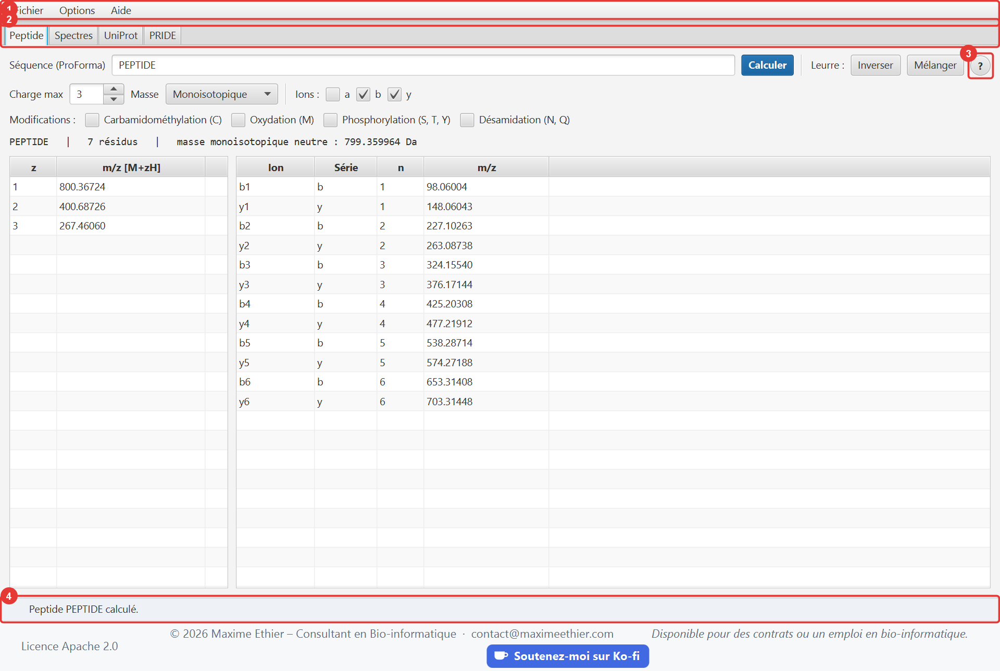

# ProteoSpectra-Explorer

Outil de protéomique en Java 21 qui permet de :

- lire des spectres de masse JSON (simplifié ou PROXI de PRIDE) et MGF, compressés ou non ;
- interroger UniProt, rechercher des projets PRIDE et télécharger leurs fichiers de spectres ;
- calculer les masses théoriques des peptides, avec des modifications courantes
  (carbamidométhylation, oxydation, phosphorylation, désamidation) ou sous forme de leurres
  inversés ou mélangés ;
- annoter les spectres MS/MS et les comparer, en miroir ou superposés, à un spectre d'un autre
  fichier ou au spectre théorique d'un peptide, avec un score de similarité cosinus.

Le même modèle est servi par deux applications indépendantes, toutes deux en architecture MVC :
une application **desktop JavaFX** et une application **web React**.



## Organisation du dépôt

```
core/            Modèle partagé (Maven, pride-core) : données, parseurs, calcul de masses,
                 digestion, clients UniProt/PRIDE et façade ProteomicsService
desktop/         Application desktop (Maven, pride-desktop) : vue JavaFX, contrôleurs, aide, i18n
web/
  server/        API REST (Maven, pride-server) : contrôleurs HTTP qui exposent le modèle
  client/        Application web (npm) : React + TypeScript + Vite
samples/         Fichiers de spectres d'exemple, livrés avec les deux applications
config/          Règles Checkstyle communes aux modules Java
```

### Architecture MVC

| Couche | Desktop | Web |
|---|---|---|
| Modèle | `core` (`ProteomicsService`) + `DesktopModel` observable | `core` via l'API REST ; `client/src/model` (accès HTTP, types) |
| Vue | FXML : `main-view.fxml` et un fichier par onglet | `client/src/views` (composants React sans logique métier) |
| Contrôleur | `MainController` + un contrôleur par onglet | `web/server/.../controller` (REST) et `client/src/controllers` (hooks) |

Les vues ne contiennent aucun calcul : elles affichent l'état exposé par le modèle et transmettent
les actions de l'utilisateur à leur contrôleur.

## Application desktop

- Interface **bilingue français/anglais** (menu *Options › Langue*). La langue est mémorisée.
- **Taille du texte** réglable (menu *Options › Taille du texte*, ou Ctrl + / Ctrl − / Ctrl 0).
  Elle est mémorisée.
- Menu **Aide** :
  - **guide d'utilisateur** illustré (F1), avec barre de recherche et une section par onglet ;
  - bouton **?** dans chaque onglet, qui ouvre directement la section correspondante ;
  - raccourcis clavier ;
  - liens UniProt, PRIDE et ProForma ;
  - **À propos**.
- **Fichier › Ouvrir le dossier d'échantillons** : ouvre les fichiers de
  [`samples/`](samples/README.txt), qui servent à la démonstration, aux exercices et aux cas
  d'erreur.

Le guide est rédigé en Markdown :

- [`guide_fr.md`](desktop/src/main/resources/com/bioinfo/proteomics/desktop/help/guide_fr.md) ;
- [`guide_en.md`](desktop/src/main/resources/com/bioinfo/proteomics/desktop/help/guide_en.md).

Les captures d'écran et les icônes sont générées automatiquement :

```powershell
mvn -pl desktop javafx:run@screenshots   # captures FR + EN du guide (réseau requis)
mvn -pl desktop javafx:run@icons         # icônes PNG + packaging/ProteoSpectraExplorer.ico
```

### Distribution Windows

```powershell
cd desktop
.\package-windows.ps1            # ajouter -SkipTests pour aller plus vite
```

Le script produit `desktop/target/dist/ProteoSpectra-Explorer-<version>-windows-x64.zip`
(environ 56 Mo). Ce zip est autonome :

- `ProteoSpectra-Explorer.exe` ;
- un runtime Java 21 allégé par jlink, donc aucune installation de Java n'est requise ;
- le dossier `samples/`.

L'utilisateur décompresse l'archive et lance l'exécutable.

## Application web

L'application web offre les mêmes fonctions que l'application desktop, onglet par onglet : mêmes
calculs, mêmes messages FR/EN, mêmes interactions avec le graphique (zoom par glisser ou à la
molette, double-clic pour revoir tout le spectre, clic sur un pic), même comparaison avec une
référence et même guide illustré. Les seules différences tiennent au navigateur :

- **Alt+1 à Alt+4** changent d'onglet (Ctrl+1 à 4 sont réservés aux onglets du navigateur) ;
- **Fichier › Ouvrir un fichier d'exemple** remplace le dossier d'échantillons, et il n'y a pas
  de menu *Quitter* ;
- **Télécharger…** (onglet PRIDE) : le serveur télécharge le fichier, avec progression et
  annulation, puis le navigateur l'enregistre dans son dossier de téléchargement ;
- le guide s'ouvre dans un panneau à droite plutôt que dans une fenêtre ;
- la langue et la taille du texte sont mémorisées par le navigateur.

Le guide web est adapté du guide desktop :
[`guide_fr.md`](web/client/src/help/guide_fr.md), [`guide_en.md`](web/client/src/help/guide_en.md).
Ses captures sont générées en pilotant l'application dans Microsoft Edge :

```powershell
cd web/client; npm run screenshots       # API et "npm run dev" lancés, réseau requis
```

## Démarrage rapide

Prérequis : JDK 21, Maven 3.9 et Node.js 20 ou plus récent.

```powershell
mvn install -DskipTests                  # compile les modules Java
mvn -pl desktop javafx:run               # application desktop

mvn -pl web/server exec:java             # API REST sur http://127.0.0.1:7070/api
cd web/client; npm ci; npm run dev       # application web sur http://localhost:5173
```

En développement, Vite redirige les appels `/api` vers le serveur REST.

## Qualité du code

- **Lisibilité** : aucune ligne ne dépasse 100 colonnes. Le code Java est formaté avec
  google-java-format (style AOSP, indentation de 4 espaces), le code TypeScript avec Prettier.
- **Commentaires** : chaque classe et chaque méthode publique est documentée en Javadoc ou TSDoc.
- **Vérifications automatiques** :
  - Checkstyle (`config/checkstyle`) s'exécute dès la phase `validate` de Maven et fait échouer le
    build en cas de violation : longueur des lignes, Javadoc, nommage, imports, accolades ;
  - ESLint (TypeScript, règles des hooks React) et Prettier côté web ;
  - `.editorconfig` partage l'encodage, l'indentation et la largeur de ligne avec les éditeurs.

## Tests et couverture

```powershell
mvn verify                       # Checkstyle, tests JUnit 5 et couverture JaCoCo
cd web/client; npm run check     # types, ESLint, Prettier et tests Vitest
```

495 tests au total :

| Module | Tests | Contenu |
|---|---|---|
| `core` | 348 | Masses, modifications, leurres, spectres théoriques et similarité, parseurs, clients HTTP, digestion |
| `desktop` | 83 | Modèle, messages FR/EN, guide d'aide, préférences, fichiers d'échantillon |
| `web/server` | 26 | Tests d'intégration de l'API REST, téléchargements PRIDE |
| `web/client` | 38 | Modèle (dernier appel gagnant, référence, téléchargements), accès à l'API, zoom, règles PRIDE, préférences, messages FR/EN, guide d'aide, pied de page |

Les masses théoriques sont validées par :

- des valeurs de référence (PEPTIDE, Leu-enképhaline, angiotensine II, bradykinine,
  Glu-fibrinopeptide B, substance P amidée) ;
- la complémentarité des ions b/y (b_i + y_{n−i} = M + 2H) ;
- la masse moyenne UniProt de l'hémoglobine α ;
- un vrai spectre PRIDE.

JaCoCo fait échouer le build si la couverture de `core` passe sous **95 % des lignes** et
**90 % des branches**, ou sous **98 % des lignes** pour le package `mass`. Le rapport est dans
`core/target/site/jacoco/index.html`.

## API REST

| Méthode | Route | Description |
|---|---|---|
| GET | `/api/health` | État du serveur |
| GET | `/api/peptide?sequence=…&maxCharge=3&massType=MONOISOTOPIC&ions=b,y&modifications=oxidation,phospho` | Masses et fragments d'un peptide (`modifications` : carbamidomethyl, oxidation, phospho, deamidation) |
| GET | `/api/peptide/decoy?sequence=…&method=REVERSE` | Leurre inversé (`REVERSE`) ou mélangé (`SHUFFLE`) : `{sequence}` |
| POST | `/api/spectra/parse?mode=LENIENT&name=run.mgf.gz` | Corps : fichier JSON ou MGF brut, compressé ou non. Réponse : `{spectra, issues}` |
| POST | `/api/spectra/annotate` | `{spectrum, peptide, tolerance, unit, massType}` |
| POST | `/api/spectra/theoretical` | `{peptide, spectrum, massType}` : spectre théorique d'un peptide |
| POST | `/api/spectra/compare` | `{first, second, tolerance, unit}` : similarité cosinus |
| GET | `/api/uniprot/{accession}?protease=TRYPSIN&missedCleavages=1&minLength=6&maxLength=30&massType=MONOISOTOPIC` | Fiche UniProt et digestion |
| GET | `/api/pride/projects?q=…&page=0&pageSize=25` | Recherche paginée de projets PRIDE |
| GET | `/api/pride/projects/{PXD}` | Métadonnées d'un projet PRIDE |
| GET | `/api/pride/projects/{PXD}/files` | Fichiers d'un projet |
| GET | `/api/pride/projects/{PXD}/files/size?name=…` | Taille exacte d'un fichier : `{sizeBytes}` |
| GET | `/api/pride/spectrum?usi=mzspec:…` | Spectre PRIDE identifié par son USI |
| POST | `/api/pride/downloads?accession=PXD…&name=…&size=…&mode=LENIENT` | Lance le téléchargement d'un fichier de spectres, qui sera lu |
| POST | `/api/pride/downloads?accession=PXD…&name=…&size=…&save=true` | Lance le téléchargement d'un fichier de n'importe quel format, à enregistrer |
| GET | `/api/pride/downloads/{id}` | Progression : `state`, `receivedBytes`, `totalBytes` |
| GET | `/api/pride/downloads/{id}/spectra` | Spectres lus, une fois le téléchargement terminé |
| GET | `/api/pride/downloads/{id}/file` | Fichier téléchargé avec `save=true`, envoyé en pièce jointe |
| DELETE | `/api/pride/downloads/{id}` | Annule le téléchargement et supprime le fichier partiel |

Codes d'erreur (le corps contient `error`, la catégorie `kind` traduite par le client et, si
possible, `location`) :

- **400** : entrée invalide (`PARSING`, `INVALID_INPUT`).
- **404** : ressource introuvable.
- **405** : méthode HTTP non permise sur cette route.
- **409** : opération impossible dans l'état actuel (`INVALID_STATE`).
- **413** : corps JSON supérieur à 10 Mo, ou fichier envoyé supérieur à 1 Go (`TOO_LARGE`).
- **502** : service distant (UniProt ou PRIDE) indisponible.

## Licence

Copyright 2026 Maxime Ethier - Consultant en Bioinformatique/Biocomputing Consultant.

Ce projet est distribué sous la licence Apache 2.0 : voir le fichier [`LICENSE`](LICENSE).
L'application Web publie ce fichier sous le nom `LICENSE.txt` et y renvoie depuis son pied de
page.
