**ProteoSpectra-Explorer — User guide** · [Version française](guide_fr.md)

This guide is shown in the application by the **Help > User guide** menu (**F1** key).
Each heading below is a section of the help window.

<!-- section: start -->
# Getting started

ProteoSpectra-Explorer computes theoretical peptide masses, reads and annotates MS/MS mass
spectra, digests UniProt proteins *in silico*, searches PRIDE projects and downloads their spectrum
files.

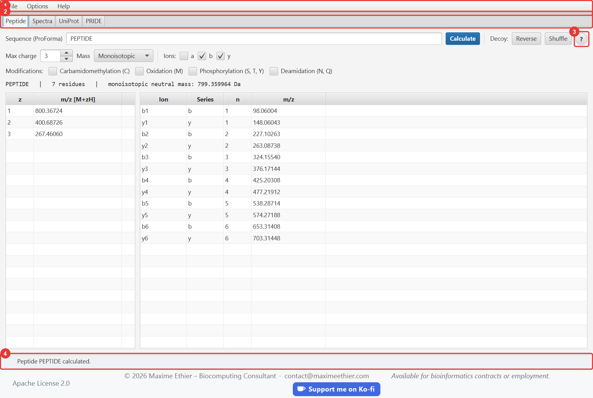

| # | Element | Purpose |
|---|---|---|
| 1 | Menu bar | **File** (open spectra, sample folder), **Options** (language, text size), **Help** (this guide, shortcuts, About). |
| 2 | Tabs | **Peptide**, **Spectra**, **UniProt**, **PRIDE**. Shortcuts: Ctrl+1 to Ctrl+4. |
| 3 | “?” button | Opens this guide directly at the section of the current tab. |
| 4 | Status bar | Result of the last action. It turns **red on errors**; a spinner turns during network requests. |

The footer, at the very bottom, gives the licence of the application at the left, then the author’s
contact details (website and e-mail) and a **Support me on Ko-fi** button to support the
development of the application with a donation.

## Where to start?

1. **Peptide** tab: type `PEPTIDE`, then **Calculate**.
2. **Spectra** tab: **Open file…**, choose `01-demo-peptides.json` in the `samples` folder, then
   **Annotate**.
3. **UniProt** tab: click **Query UniProt** (accession `P69905` is already filled in).

> The UniProt and PRIDE tabs, and downloading a spectrum by USI, need an Internet connection. The
> Peptide and Spectra tabs (local files) work offline.

Hover over a field or button to show an explanatory **tooltip**.

<!-- section: peptide -->
# Peptide tab

Computes the mass of a peptide, its m/z values and its fragment ions.

## Simple calculation

Type a sequence and click **Calculate** (or press Enter).

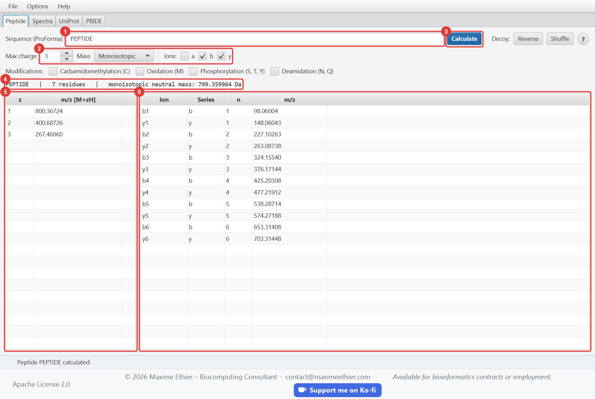

| # | Element | Description |
|---|---|---|
| 1 | Sequence | One-letter peptide sequence, with or without modifications (see below). Upper or lower case. |
| 2 | Options | **Max charge**: number of charge states listed (1 to 10). **Mass**: monoisotopic or average. **Ions a / b / y**: fragment series to compute. The **Modifications** boxes are described below. |
| 3 | Calculate | Runs the calculation. |
| 4 | Summary | Normalized sequence, length, neutral mass (M) in daltons. |
| 5 | Charge states | m/z of the [M+zH]z+ ion for z = 1 to max charge. |
| 6 | Fragments | Singly charged a/b/y ions sorted by m/z; *n* is the number of residues of the fragment. |

Reference values for `PEPTIDE`: M = 799.359964 Da; [M+H]+ = 800.36724; [M+2H]2+ = 400.68726; b2 =
227.10263; y1 = 148.06043.

**Monoisotopic or average mass?** The monoisotopic mass (lightest isotope of every element) is the
first peak of the isotopic envelope: use it with high-resolution mass spectrometers. The average
mass accounts for natural isotopic abundances; it is used for large molecules or low resolution.

## Modified peptides (ProForma notation)

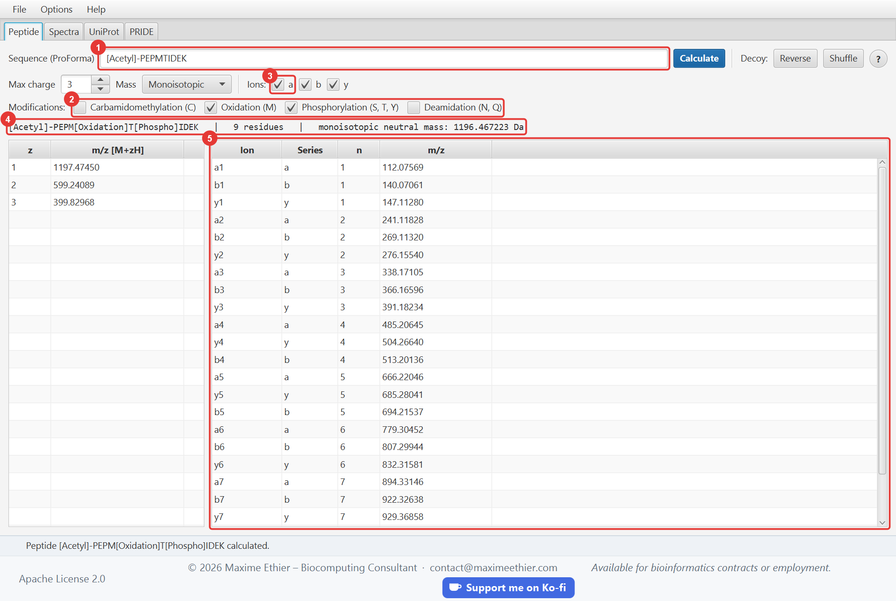

| # | Element | Description |
|---|---|---|
| 1 | Modified sequence | Here, an N-terminal acetylation written in the sequence. |
| 2 | Common modifications | Ticked boxes: oxidation and phosphorylation are added to every target residue (see the table below). |
| 3 | a ions | The a series is ticked: it is added to the b and y series in the table. |
| 4 | Summary | The normalized sequence shows where the modifications were placed; the mass includes them. |
| 5 | Fragments | b ions are shifted by +42.011 Da by the N-terminal acetyl, then by +15.995 Da (oxidized methionine) and +79.966 Da (phosphorylated threonine) once they contain these residues. |

The **Modifications** boxes add the mass of a frequent modification to **every** target residue
of the sequence, without writing it:

| Box | Target residues | Mass shift |
|---|---|---|
| Carbamidomethylation (C) | Cysteine | +57.021 Da (iodoacetamide alkylation) |
| Oxidation (M) | Methionine | +15.995 Da |
| Phosphorylation (S, T, Y) | Serine, threonine, tyrosine | +79.966 Da (HPO₃ group) |
| Deamidation (N, Q) | Asparagine, glutamine | +0.984 Da |

A residue already modified in the sequence keeps the written modification: with the
Phosphorylation box, `S[Phospho]AS[+42]K` gets no second phosphate. To phosphorylate **one**
residue only, leave the box unticked and write the modification in place: `PEPS[Phospho]TIDE`.

> The monoisotopic mass of the phosphate is 79.966 Da; the often quoted 79.98 Da is its average
> mass, used when **Mass** is set to "Average".

Accepted syntax:

| Notation | Meaning |
|---|---|
| `PEPM[Oxidation]IDE` | Named modification, placed **after** the modified residue |
| `PEPS[UNIMOD:21]IDE` | Modification given by its Unimod number |
| `PEPS[+79.966]IDE` | Free mass shift in Da (the sign is optional) |
| `[Acetyl]-PEPTIDE` | N-terminal modification (note the hyphen) |
| `PEPTIDE-[Amidated]` | C-terminal modification |
| `K[Methyl][Methyl]` | Several modifications on the same residue |

Modifications recognized by name: `Carbamidomethyl` (+57.021), `Oxidation` (+15.995), `Phospho`
(+79.966), `Acetyl` (+42.011), `Deamidated` (+0.984), `Methyl` (+14.016), `Amidated` (−0.984), `Gln->pyro-Glu` (−17.027),
`Glu->pyro-Glu` (−18.011), `Dioxidation` (+31.990), `Hex` (+162.053). For any other modification, use a mass shift, for example `[+229.163]` for TMT.

## Decoy peptides

Search engines estimate their false discovery rate by also searching **decoy** peptides, which do
not exist in the sample. The **Decoy** buttons replace the sequence by a decoy and calculate it
with the chosen options:

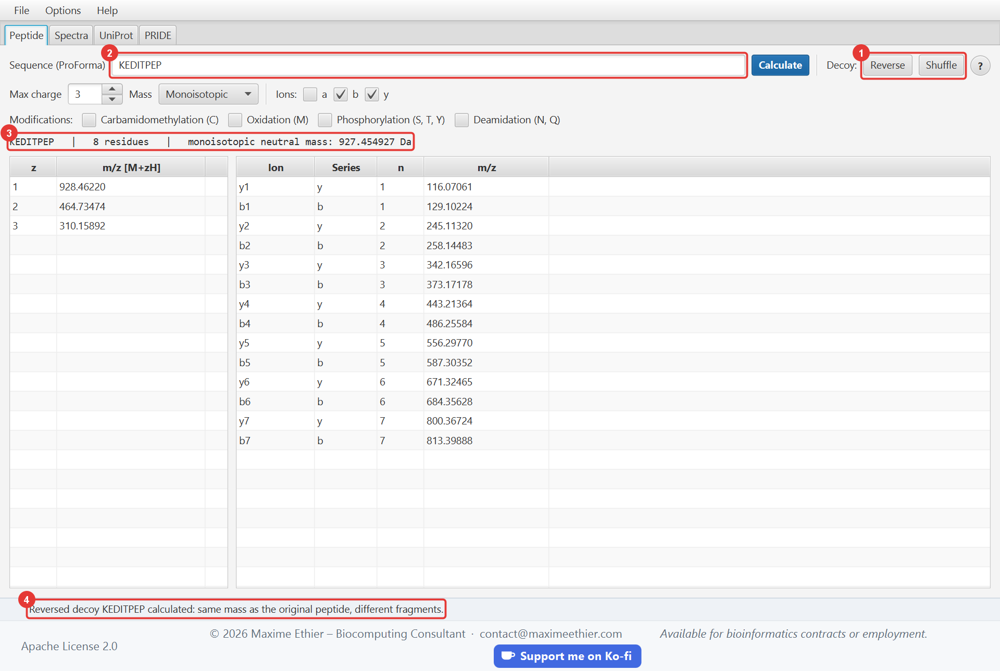

| # | Element | Description |
|---|---|---|
| 1 | Reverse / Shuffle | **Reverse** reads the residues backwards (`ACDEFGH` becomes `HGFEDCA`). **Shuffle** puts them in a random order; each click gives a new order. |
| 2 | Sequence | Replaced by the decoy; clicking **Reverse** again gives back the original sequence. |
| 3 | Summary | Mass of the decoy. |
| 4 | Status bar | Reminds that the mass does not change. |

A decoy contains exactly the same residues: its **mass and m/z values are identical** to those of
the original peptide, which makes it a credible competitor. Only its **fragment ions** change, and
they are what lets the spectrum tell the true peptide from the decoy. Modifications follow their
residue; terminal modifications stay on the termini.

## Input errors

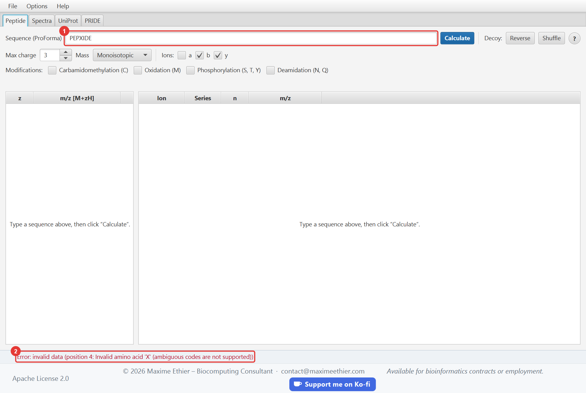

| # | Element | Description |
|---|---|---|
| 1 | Invalid sequence | `PEPXIDE` contains `X`, an ambiguous code with no defined mass. |
| 2 | Status bar | The red message gives the **position** of the offending character (here the 4th). |

The ambiguous codes `B`, `J`, `X` and `Z` are rejected, as are unknown modifications and unclosed
brackets. The 22 standard amino acids (including `U` selenocysteine and `O` pyrrolysine) are
accepted.

<!-- section: spectra -->
# Spectra tab

Opens MS/MS spectra (JSON or MGF file, or PRIDE) and checks that a peptide explains them by finding
its b and y ions.

## Opening a file

Click **Open file…** (or **File > Open spectrum file…**, Ctrl+O). The first time, the dialog opens
on the **sample files** folder shipped with the application. Here,
`02-hemoglobin-alpha-tryptic.json`:

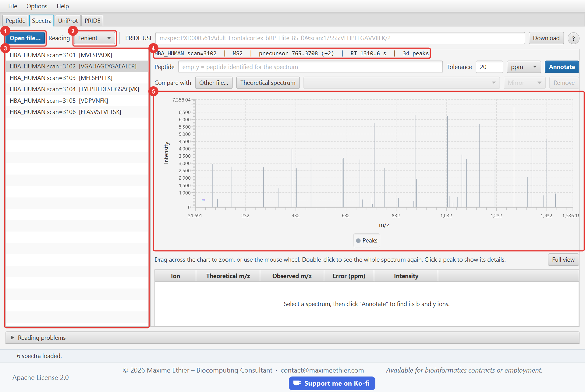

| # | Element | Description |
|---|---|---|
| 1 | Open file… | Opens a JSON or MGF spectrum file, compressed (`.gz`) or not. **Loading replaces the current list.** |
| 2 | Reading | **Lenient**: invalid spectra or peaks are skipped and reported. **Strict**: the first error rejects the whole file. Choose it **before** opening the file. |
| 3 | Spectrum list | Click to select a spectrum; the identified peptide is shown in brackets. |
| 4 | Details | Identifier, MS level, precursor m/z and charge, retention time (RT), number of peaks. |
| 5 | Chart | Stick spectrum: m/z on the x axis, intensity on the y axis. Enlarge the window for more detail. |

## Annotating a spectrum

Annotation looks for the peaks of the spectrum that match the theoretical b and y ions of a peptide.

1. Select a spectrum in the list.
2. Leave the **Peptide** field empty to use the spectrum’s identification, or type another peptide
   to test it.
3. Adjust the **tolerance** if needed (20 ppm by default).
4. Click **Annotate** (or press Enter in the Peptide field).

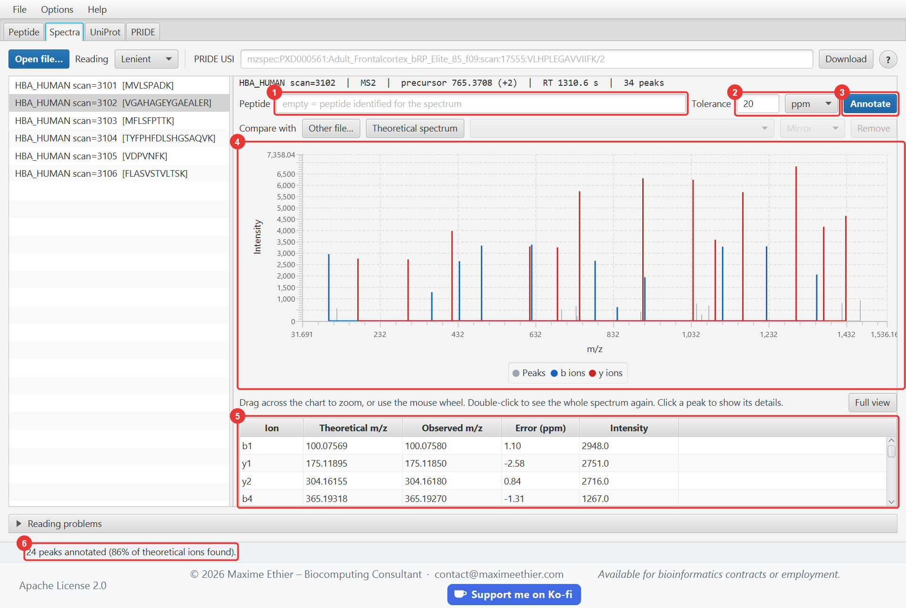

| # | Element | Description |
|---|---|---|
| 1 | Peptide | Empty = peptide of the spectrum. Same notation as the Peptide tab. |
| 2 | Tolerance | Maximum difference between observed and theoretical m/z, in **ppm** (relative) or **Da** (absolute). Orbitrap: 10 to 20 ppm. Ion trap: about 0.5 Da. |
| 3 | Annotate | Runs the annotation. |
| 4 | Annotated chart | **Blue**: b ions (N-terminal). **Red**: y ions (C-terminal). **Grey**: unexplained peaks. |
| 5 | Annotation table | For each explained peak: ion, theoretical m/z, observed m/z, error in ppm, intensity. |
| 6 | Status bar | Number of annotated peaks and **coverage** (share of theoretical ions found). |

**Reading the result**: a high coverage with small, consistent errors (a few ppm) means the peptide
explains the spectrum well. To compare, type another peptide (for example `PEPTIDE`): far fewer
peaks are annotated.

> Selecting another spectrum clears the annotation: click **Annotate** again for the new spectrum.
> For a precursor of charge z, fragments are searched up to charge z − 1.

## Zooming and inspecting a peak

A spectrum often has hundreds of closely spaced peaks. The chart lets you look closer:

- **Drag** horizontally across the chart: zooms into the selected m/z range.
- Mouse **wheel**: zooms in or out around the pointer.
- **Double-click** or the **Full view** button: shows the whole spectrum again.
- **Click a peak**: the peak is highlighted in orange and described below the chart (m/z,
  intensity, percentage of the base peak). If it is annotated, the ion, its theoretical m/z and the
  error in ppm are shown, and its row is selected in the annotation table.

The intensity axis fits the highest peak of the visible range, so small peaks stay readable after
zooming. Conversely, selecting a row of the annotation table highlights the matching peak. The
zoom is kept when you annotate the same spectrum again.

## Comparing with a reference spectrum

The **Compare with** row draws a second spectrum in **mirror** (downwards) or **overlaid**
(upwards), and measures how similar they are. The reference can be:

- the **theoretical** spectrum of the peptide typed in the Peptide field, or of the peptide
  identified in the spectrum if the field is empty; it then follows the identification when you
  select another spectrum;
- a spectrum of **another file**, MGF or JSON (**Other file…** button); the spectrum identified
  with the same peptide is chosen first;
- a spectrum of the list: right-click, **Use as reference spectrum**.

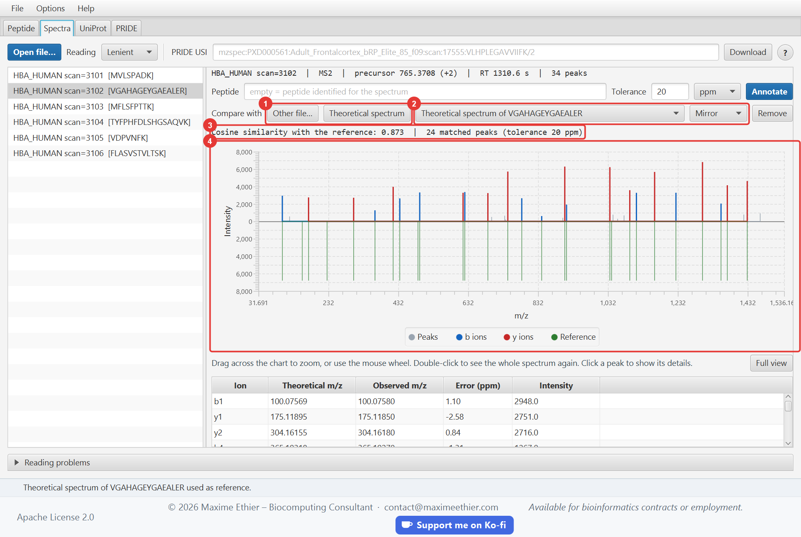

| # | Element | Description |
|---|---|---|
| 1 | Other file… / Theoretical spectrum | Chooses where the reference comes from. |
| 2 | Reference and display | Reference spectra available; **Mirror** or **Overlay**. **Remove** stops the comparison. |
| 3 | Similarity | Cosine between the two spectra, from 0 (no common peak) to 1 (same peaks, proportional intensities), and number of matched peaks. |
| 4 | Chart | The reference is **green**, scaled to the base peak of the selected spectrum. |

Peaks are matched with the annotation **tolerance**. The cosine uses square-rooted intensities,
the usual practice, so that a few dominant peaks do not hide the others. A theoretical spectrum
gives the same intensity to all its ions (half for doubly charged ions): a cosine of 0.6 to 0.9
with a real spectrum is already a good match. Two experimental spectra of the same peptide often
exceed 0.9.

## Reading problems

The sample file `07-parsing-errors.json` deliberately contains errors. In **Lenient** mode, the
valid entries are loaded and every problem is listed at the bottom of the tab, which expands
automatically:

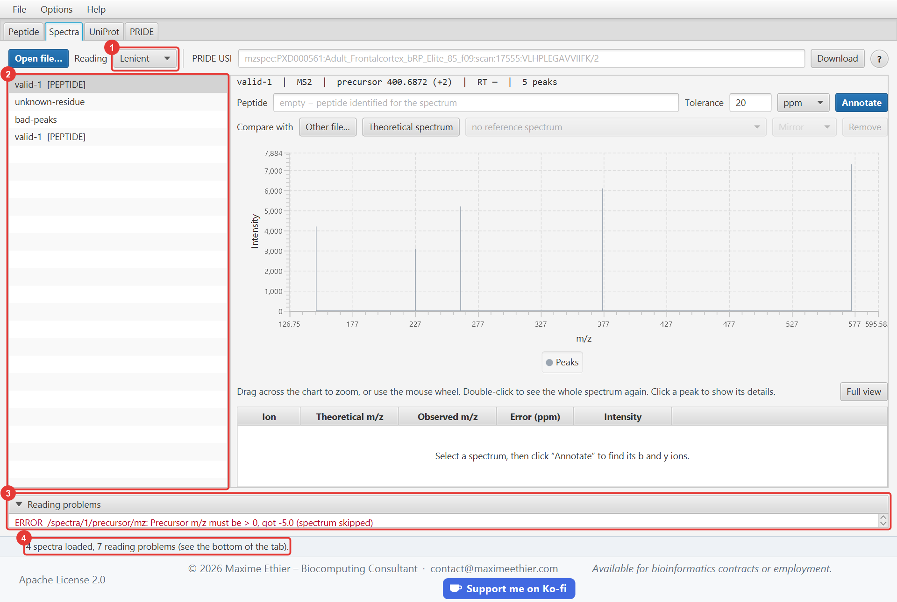

| # | Element | Description |
|---|---|---|
| 1 | Reading | Lenient mode: the file is loaded despite the errors. In Strict mode, loading would fail at the first error. |
| 2 | Loaded spectra | Only valid (or repairable) spectra are listed. |
| 3 | Reading problems | Each line gives the severity, the **location** in the file (`/spectra/1/precursor/mz` = 2nd spectrum, precursor.mz field) and the cause. **ERROR**: spectrum skipped. **WARNING**: peak or identification skipped, spectrum kept. |
| 4 | Status bar | Number of spectra loaded and of problems. |

## Downloading a spectrum from PRIDE (USI)

A USI (*Universal Spectrum Identifier*) designates one spectrum in a public dataset. Paste it in the
**PRIDE USI** field, then click **Download**. The grey text of the empty field is only an example;
to copy:

```
mzspec:PXD000561:Adult_Frontalcortex_bRP_Elite_85_f09:scan:17555:VLHPLEGAVVIIFK/2
```

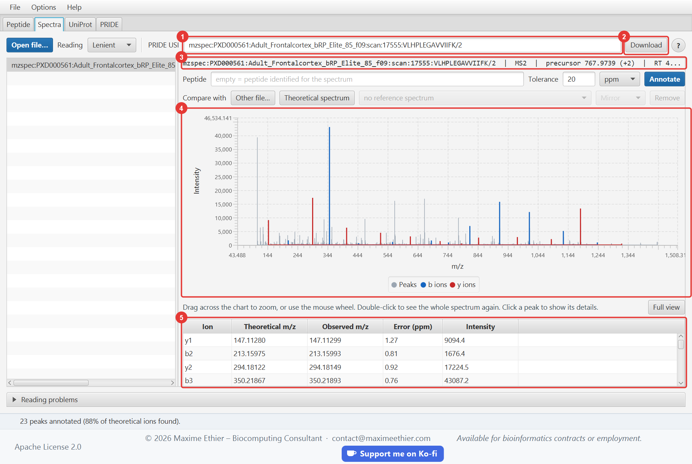

| # | Element | Description |
|---|---|---|
| 1 | PRIDE USI | Identifier of the spectrum. The end, `VLHPLEGAVVIIFK/2`, is the identified peptide and its charge. |
| 2 | Download | Fetches the spectrum through the PRIDE PROXI API. |
| 3 | Details | 564 peaks, precursor 767.9739 (2+); the theoretical value is 767.9714, a 3.3 ppm difference. |
| 4 | Chart | After **Annotate**: 23 peaks explained, i.e. 88% of the theoretical b/y ions. |
| 5 | Annotations | Mass errors all below 2 ppm. |

The same spectrum is available offline: `samples/04-pride-proxi-VLHPLEGAVVIIFK.json`.

<!-- section: uniprot -->
# UniProt tab

Fetches a protein from UniProtKB and digests it *in silico* to list its theoretical peptides.

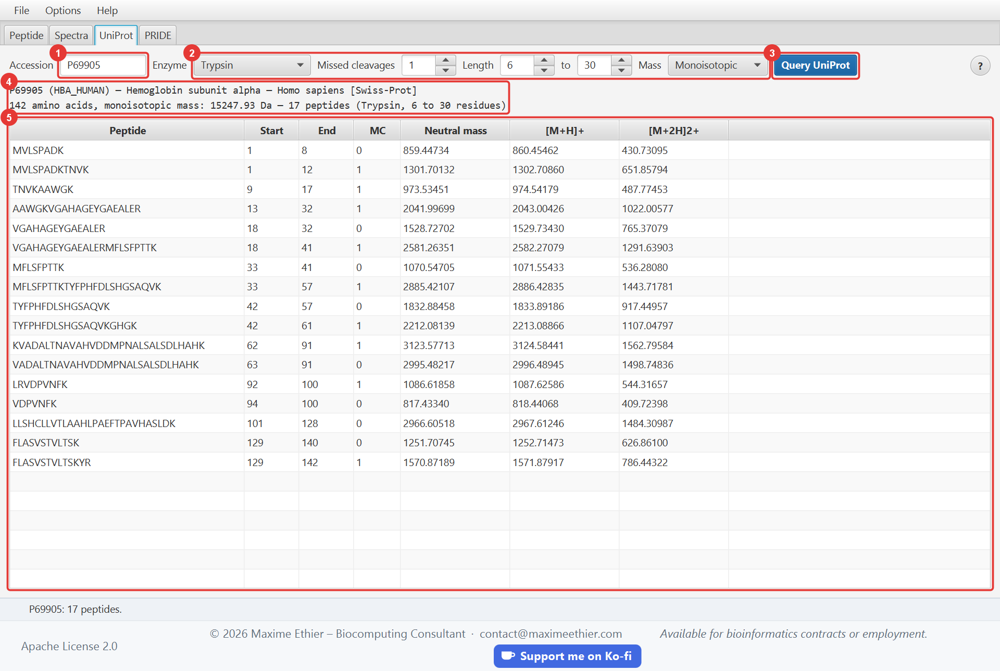

| # | Element | Description |
|---|---|---|
| 1 | Accession | For example `P69905` (human hemoglobin alpha), `P02769` (bovine albumin) or `P00924` (yeast enolase). An isoform is written `P69905-2`. |
| 2 | Parameters | **Enzyme**: Trypsin (cleaves after K/R except before P), Trypsin/P (also before P), Lys-C (after K), Arg-C (after R), Glu-C (after E), Asp-N (before D), Chymotrypsin (after F/Y/W except before P). **Missed cleavages**: number of uncleaved internal sites allowed. **Length**: length range of the peptides kept (6 to 30 residues by default; raise the maximum for Lys-C or Glu-C, which produce longer peptides). **Mass**: monoisotopic or average. |
| 3 | Query UniProt | Downloads the UniProt entry and computes the digestion. |
| 4 | Summary | Protein name, organism, Swiss-Prot (reviewed) or TrEMBL status, length, total mass, number of peptides. |
| 5 | Peptides | Peptides within the chosen length range: start and end positions (1-based), missed cleavages (MC), neutral mass, [M+H]+ and [M+2H]2+. |

With the **average** mass, P69905 weighs about 15,258 Da, the value given by UniProt. Peptides
containing ambiguous residues (`X`, `B`, `Z`) are excluded and counted separately in the summary.

**Sending a peptide to another tab**:

- **Double-click** a peptide: it is computed in the Peptide tab (fragment ions, charge states),
  with the options chosen in that tab.
- **Right-click** a peptide: *Calculate in the Peptide tab*, *Annotate the selected spectrum with
  this peptide* (Spectra tab) or *Copy sequence*.

> Tip: the spectra of `samples/02-hemoglobin-alpha-tryptic.json` and
> `05-unidentified-spectra.json` come from tryptic peptides of P69905. Select a spectrum in the
> Spectra tab, compare its precursor m/z with the [M+2H]2+ column, then right-click the candidate
> peptide › *Annotate the selected spectrum with this peptide*.

<!-- section: pride -->
# PRIDE tab

Searches the projects deposited in PRIDE Archive, the public proteomics data repository of EMBL-EBI,
displays their details and files, and downloads their spectra into the **Spectra** tab.

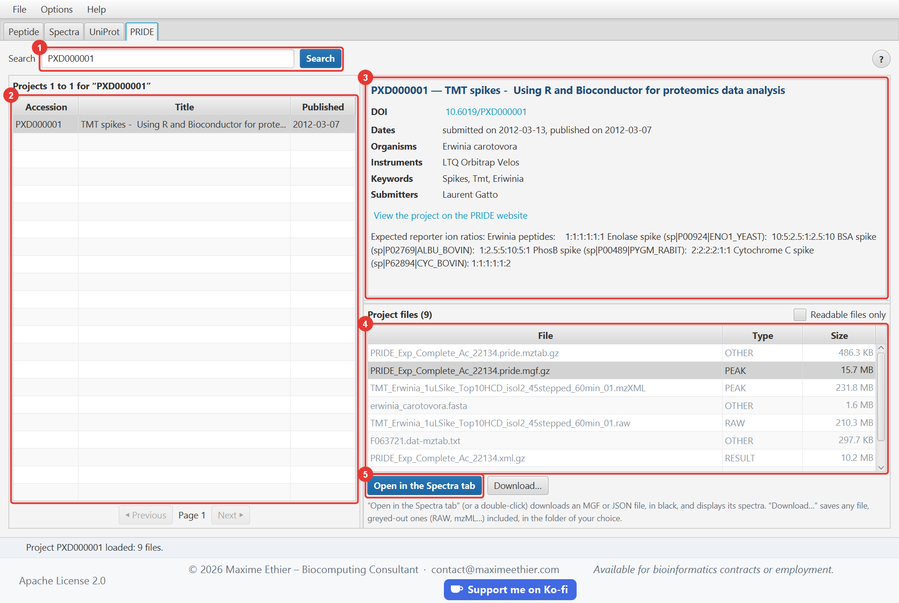

| # | Element | Description |
|---|---|---|
| 1 | Search | An accession (PXD followed by 6 digits, for example `PXD000001`) opens the project directly. Keywords (`hemoglobin human`, a species or instrument name…) start a search. |
| 2 | Results | 25 projects per page; **Previous** and **Next** change the page. Click a project to display its details and files. |
| 3 | Project record | Title, DOI (clickable), dates, organisms, instruments, keywords, submitters and description, with a link to the project page on the PRIDE website. |
| 4 | Project files | Name, type and size of each file. Greyed-out files cannot be read by the application; tick **Readable files only** to hide them. |
| 5 | Open in the Spectra tab | Downloads the selected file (or double-click its row), then displays its spectra in the **Spectra** tab. The button next to it, **Download…**, saves the file in the folder of your choice. |

## Downloading the files of a project

Two buttons, below the file list:

- **Open in the Spectra tab** (or double-click): for **MGF** and **JSON** files, compressed
  (`.gz`) or not. The file is downloaded into a temporary folder, then its spectra are displayed in
  the **Spectra** tab. Raw instrument files (`.raw`, `.wiff`…), the mzML and mzXML formats, and
  identification results cannot be read.
- **Download…**: for **any file**, greyed-out ones included. Choose a folder (your *Downloads*
  folder by default): the file is saved there under its original name, and the status bar tells
  where. The application remembers the chosen folder.

Before downloading, the application asks the server for the exact size of the file. Above **50 MB**,
or when the size is unknown, a warning dialog shows the size and asks you to confirm or cancel.
During the download, a progress bar and a **Cancel** button appear below the file list; the status
bar shows the percentage received.

> PRIDE servers limit the speed of each connection, so the application downloads files larger than
> 2 MB in several parts at once. Still, allow about 30 seconds for the 6 MB MGF file of
> `PXD000001`.

> A file is never downloaded twice: one saved with **Download…** opens at once in the Spectra tab,
> and one already opened is simply copied by **Download…**. Opened files stay in the temporary
> folder of the system.

> The size shown in the list is the one declared by PRIDE; it sometimes differs from the actual size,
> which the warning dialog shows.

To open a single spectrum of a project, use its USI in the **Spectra** tab instead.

<!-- section: samples -->
# Sample files

The `samples` folder, shipped next to the application, contains files ready to analyze. Open it with
**File > Open sample files folder**. The **Open file…** dialog opens there automatically the first
time.

| File | Content | Try this |
|---|---|---|
| `01-demo-peptides.json` | 3 identified spectra: PEPTIDE, ELVISLIVESK, SAMPLER | Select each spectrum, then **Annotate** (75 to 90% coverage). |
| `02-hemoglobin-alpha-tryptic.json` | 6 tryptic peptides of human hemoglobin alpha (P69905), one of them 3+ | Compare with the digestion of P69905 in the UniProt tab. |
| `03-ptm-modifications.json` | Modified peptides: acetylation, oxidation, phosphorylation, carbamidomethylation, mass shift, C-terminal amidation | Annotate, then remove the modification in the Peptide field: coverage drops. |
| `04-pride-proxi-VLHPLEGAVVIIFK.json` | Real spectrum from PRIDE project PXD000561 (Orbitrap Velos), PROXI format | Annotate: 23 peaks, 88% coverage, errors below 2 ppm. |
| `05-unidentified-spectra.json` | 3 spectra **without** identification (unknown-A, B, C) | Exercise: find the peptide (see below). |
| `06-peak-formats.json` | The three ways to write peaks: objects, parallel arrays, pairs with quoted numbers | Template for writing your own files. |
| `07-parsing-errors.json` | 7 entries, several of them invalid | Open in **Lenient** mode, then in **Strict** mode, and compare. |

Files `01`, `02`, `03` and `05` are **synthetic** spectra: peaks computed from the sequence, with a
mass error of a few ppm, missing ions and noise peaks. File `04` is a real public spectrum.

## Exercise: identifying an unknown spectrum

1. Open `05-unidentified-spectra.json` and select `unknown-A`. Note its precursor m/z and charge.
2. In the **UniProt** tab, digest `P69905` (Trypsin, 1 missed cleavage) and look for a peptide whose
   [M+2H]2+ column equals that m/z (within 0.01).
3. Go back to the **Spectra** tab, type that peptide in the **Peptide** field and click
   **Annotate**. A coverage above 60% confirms the identification; try a wrong candidate to compare.

Solutions: unknown-A = `VGAHAGEYGAEALER`, unknown-B = `MFLSFPTTK`, unknown-C = `FLASVSTVLTSK`.

<!-- section: json-format -->
# JSON file format

The reader accepts three document shapes: a single spectrum object, an array of spectra, or an
object `{ "spectra": [ ... ] }`.

```json
{
  "spectra": [
    {
      "id": "scan=1001",
      "msLevel": 2,
      "retentionTime": 1520.4,
      "peptide": "PEPTIDE",
      "precursor": { "mz": 400.6872, "charge": 2 },
      "peaks": [
        { "mz": 148.0604, "intensity": 4200 },
        [ 263.0874, 5200 ]
      ]
    }
  ]
}
```

| Field | Required | Description |
|---|---|---|
| `id` | no | Identifier. Defaults to `index=0`, `index=1`… Duplicates are reported. |
| `msLevel` | no | 1, 2… Defaults to 2 when there is a precursor, otherwise 1. |
| `precursor` | no | `{ "mz": …, "charge": … }`. `precursorMz` and `precursorCharge` at the root of the spectrum are accepted too. |
| `retentionTime` (or `rt`) | no | In seconds, positive. |
| `peptide` (or `sequence`) | no | Identified peptide, in ProForma notation. If invalid, it is ignored in Lenient mode. |
| `peaks` | **yes*** | List of peaks: objects `{ "mz", "intensity" }` or pairs `[mz, intensity]`. |
| `mz` + `intensity` | **yes*** | *Alternative to peaks*: two parallel arrays of the same length. |

Validation rules: m/z strictly positive, intensity positive or zero, finite numbers. Numbers written
as strings (`"400.5"`) are accepted. Duplicate keys and malformed JSON are rejected; the line and
column of the error are then given.

The **PROXI** format returned by PRIDE (`usi`, `mzs`, `intensities`, `attributes` with PSI-MS codes)
is recognized automatically: a spectrum downloaded from PRIDE opens as is.

<!-- section: options -->
# Menus, language and text size

## File menu

- **Open spectrum file…** (Ctrl+O): shows the Spectra tab and opens a JSON or MGF file.
- **Open sample files folder**: opens the `samples` folder in the file explorer.
- **Quit** (Ctrl+Q).

## Options menu

- **Language**: English or Français. The interface and this guide switch language immediately,
  without losing the displayed results.
- **Text size**: Small, Normal, Large, Extra large, or fine-tuning with **Larger text** (Ctrl+=),
  **Smaller text** (Ctrl+−) and **Default text size** (Ctrl+0). The help window and the dialogs
  follow the same setting.

The language, text size, window size and last folder opened are remembered for the next session. On
first launch, the language is the system language (English if it is not supported).

## Help menu

- **User guide** (F1): this guide, opened at the section of the current tab.
- **Keyboard shortcuts**: list of all shortcuts.
- Links to the **UniProt** and **PRIDE Archive** websites and to the **ProForma** specification.
- **About**: version, author, data sources and references.

## Searching the guide

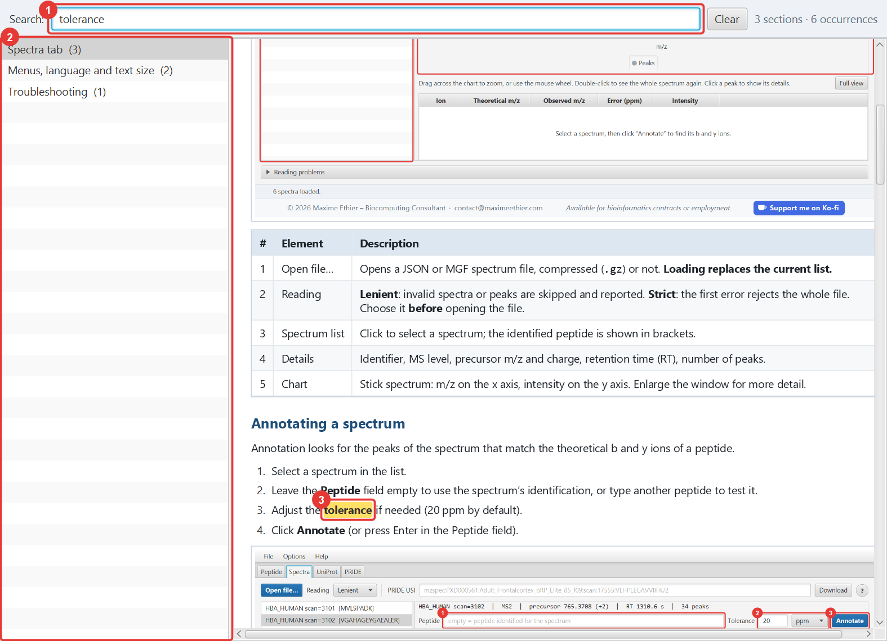

| # | Element | Description |
|---|---|---|
| 1 | Search | Type one or more words: only the sections containing **all** of them stay listed. Accents and case are ignored (`tolerance` finds “tolérance” in the French guide). Ctrl+F puts the cursor in this field, Esc clears it. |
| 2 | Sections | One section per tab of the application, plus general topics. The number of occurrences is shown in parentheses. |
| 3 | Content | Found words are highlighted in yellow; the page scrolls to the first occurrence. |

<!-- section: troubleshooting -->
# Troubleshooting

| Symptom | Cause and solution |
|---|---|
| I cannot find the **Annotate** button | **Spectra** tab, at the end of the “Peptide” line, right of the ppm/Da choice. Enlarge the window or reduce the text size if it is cut off. |
| My previous spectra disappeared | Each file opening or download **replaces** the list. |
| “Error: invalid input (… has no identification)” when annotating | The spectrum has no associated peptide: type one in the **Peptide** field. |
| 0 peaks annotated | Tolerance too strict, wrong peptide, or missing modification (oxidized Met, carbamidomethylated Cys…). Try 0.5 Da to check. |
| “accession not found” | The accession does not exist in UniProt or PRIDE. Check it on the corresponding website (Help menu). |
| “UniProt entry … is inactive” | The entry was deleted or merged in UniProt. Look for the current accession on uniprot.org. |
| “service unreachable” | No Internet access, firewall, or service temporarily unavailable. Try again later. |
| **Open in the Spectra tab** stays greyed out | The selected file is not in MGF or JSON format, or a download is already running. To save it anyway, use **Download…**. |
| Downloading a PRIDE file takes very long | PRIDE servers are sometimes slow. Click **Cancel** and choose a smaller file, or try again later. |
| The text is too small or too large | **Options > Text size** menu, or Ctrl+= / Ctrl+− / Ctrl+0. |
| The interface is in French | **Options > Language > English** menu. |
