**ProteoSpectra-Explorer — Guide d’utilisation** · [English version](guide_en.md)

Ce guide est affiché dans l’application par le menu **Aide > Guide d’utilisation** (touche **F1**).
Chaque titre ci-dessous correspond à une section de la fenêtre d’aide.

<!-- section: start -->
# Démarrage

ProteoSpectra-Explorer calcule les masses théoriques des peptides, lit et annote des spectres de
masse MS/MS, digère *in silico* des protéines UniProt, recherche des projets PRIDE et télécharge
leurs fichiers de spectres.


| # | Élément | Rôle |
|---|---|---|
| 1 | Barre de menus | **Fichier** (ouvrir des spectres, dossier d’exemples), **Options** (langue, taille du texte), **Aide** (ce guide, raccourcis, À propos). |
| 2 | Onglets | **Peptide**, **Spectres**, **UniProt**, **PRIDE**. Raccourcis : Ctrl+1 à Ctrl+4. |
| 3 | Bouton « ? » | Ouvre ce guide directement à la section de l’onglet affiché. |
| 4 | Barre d’état | Résultat de la dernière action. Elle passe **en rouge en cas d’erreur** ; un indicateur tourne pendant les requêtes réseau. |

Le pied de page, tout en bas, donne à gauche la licence de l’application, puis les coordonnées de
l’auteur (site web et courriel) et un bouton **Soutenez-moi sur Ko-fi** pour soutenir le
développement de l’application par un don.

## Par où commencer ?

1. Onglet **Peptide** : tapez `PEPTIDE` puis **Calculer**.
2. Onglet **Spectres** : **Ouvrir un fichier…**, choisissez `01-demo-peptides.json` dans le dossier
   `samples`, puis **Annoter**.
3. Onglet **UniProt** : cliquez sur **Interroger UniProt** (accession `P69905` déjà saisie).

> Les onglets UniProt et PRIDE, ainsi que le téléchargement d’un spectre par USI, nécessitent une
> connexion Internet. Les onglets Peptide et Spectres (fichiers locaux) fonctionnent hors ligne.

Passez la souris sur un champ ou un bouton pour afficher une **infobulle** explicative.

<!-- section: peptide -->
# Onglet Peptide

Calcule la masse d’un peptide, ses rapports m/z et ses ions fragments.

## Calcul simple

Tapez une séquence et cliquez sur **Calculer** (ou appuyez sur Entrée).

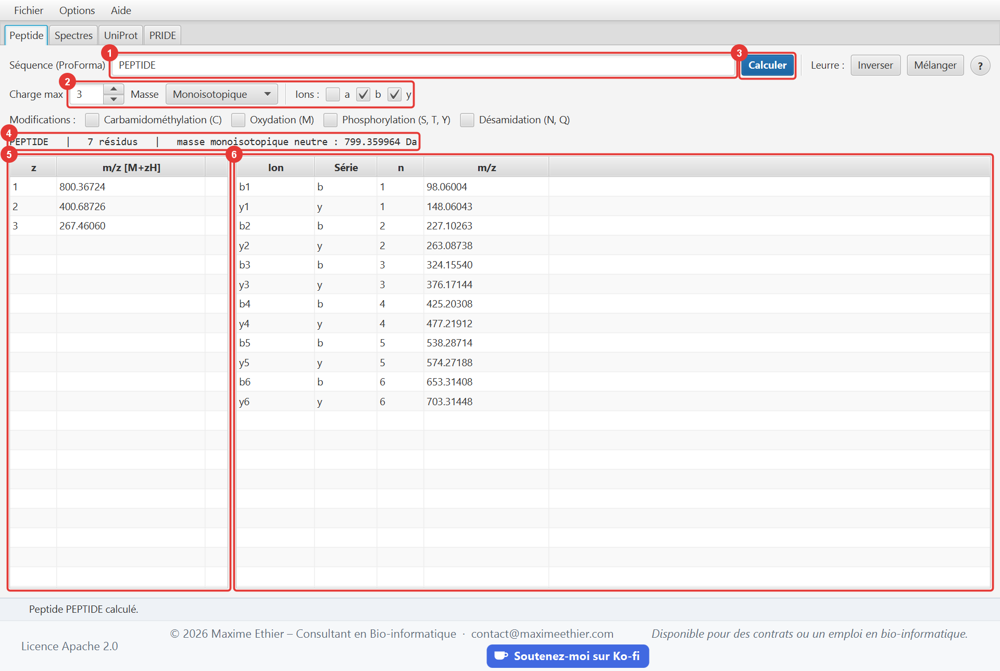

| # | Élément | Description |
|---|---|---|
| 1 | Séquence | Peptide en lettres à un caractère, avec ou sans modifications (voir plus bas). Majuscules ou minuscules. |
| 2 | Options | **Charge max** : nombre d’états de charge listés (1 à 10). **Masse** : monoisotopique ou moyenne. **Ions a / b / y** : séries de fragments à calculer. Les cases **Modifications** sont décrites plus bas. |
| 3 | Calculer | Lance le calcul. |
| 4 | Résumé | Séquence normalisée, longueur, masse neutre (M) en daltons. |
| 5 | États de charge | m/z de l’ion [M+zH]z+ pour z = 1 à la charge max. |
| 6 | Fragments | Ions a/b/y monochargés triés par m/z ; *n* est le nombre de résidus du fragment. |

Valeurs de contrôle pour `PEPTIDE` : M = 799,359964 Da ; [M+H]+ = 800,36724 ; [M+2H]2+ = 400,68726 ;
b2 = 227,10263 ; y1 = 148,06043.

**Masse monoisotopique ou moyenne ?** La masse monoisotopique (isotope le plus léger de chaque
élément) correspond au premier pic du massif isotopique : c’est elle qu’on utilise avec les
spectromètres haute résolution. La masse moyenne tient compte des abondances isotopiques
naturelles ; elle sert pour les grosses molécules ou la basse résolution.

## Peptides modifiés (notation ProForma)

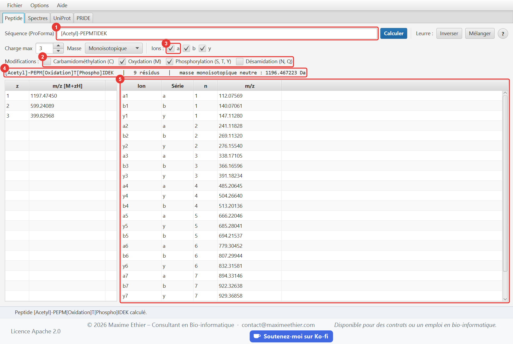

| # | Élément | Description |
|---|---|---|
| 1 | Séquence modifiée | Ici, une acétylation N-terminale écrite dans la séquence. |
| 2 | Modifications courantes | Cases cochées : l’oxydation et la phosphorylation s’ajoutent à chaque résidu ciblé (voir le tableau ci-dessous). |
| 3 | Ions a | Série a cochée : elle s’ajoute aux séries b et y dans le tableau. |
| 4 | Résumé | La séquence normalisée montre où les modifications ont été placées ; la masse les inclut. |
| 5 | Fragments | Les ions b sont décalés de +42,011 Da par l’acétyle N-terminal, puis de +15,995 Da (méthionine oxydée) et de +79,966 Da (thréonine phosphorylée) dès qu’ils contiennent ces résidus. |

Les cases **Modifications** ajoutent la masse d’une modification fréquente à **chaque** résidu
ciblé de la séquence, sans avoir à l’écrire :

| Case | Résidus ciblés | Décalage de masse |
|---|---|---|
| Carbamidométhylation (C) | Cystéine | +57,021 Da (alkylation à l’iodoacétamide) |
| Oxydation (M) | Méthionine | +15,995 Da |
| Phosphorylation (S, T, Y) | Sérine, thréonine, tyrosine | +79,966 Da (groupement HPO₃) |
| Désamidation (N, Q) | Asparagine, glutamine | +0,984 Da |

Un résidu déjà modifié dans la séquence garde la modification écrite : avec la case
Phosphorylation, `S[Phospho]AS[+42]K` ne reçoit pas de second phosphate. Pour ne phosphoryler
qu’**un** résidu, laissez la case décochée et écrivez la modification à sa place :
`PEPS[Phospho]TIDE`.

> La masse monoisotopique du phosphate est 79,966 Da ; la valeur de 79,98 Da souvent citée est
> sa masse moyenne, utilisée quand **Masse** vaut « Moyenne ».

Syntaxe acceptée :

| Écriture | Signification |
|---|---|
| `PEPM[Oxidation]IDE` | Modification nommée, placée **après** le résidu modifié |
| `PEPS[UNIMOD:21]IDE` | Modification désignée par son numéro Unimod |
| `PEPS[+79.966]IDE` | Décalage de masse libre, en Da (le signe est facultatif) |
| `[Acetyl]-PEPTIDE` | Modification N-terminale (notez le tiret) |
| `PEPTIDE-[Amidated]` | Modification C-terminale |
| `K[Methyl][Methyl]` | Plusieurs modifications sur le même résidu |

Modifications reconnues par leur nom : `Carbamidomethyl` (+57,021), `Oxidation` (+15,995), `Phospho`
(+79,966), `Acetyl` (+42,011), `Deamidated` (+0,984), `Methyl` (+14,016), `Amidated` (−0,984), `Gln->pyro-Glu` (−17,027),
`Glu->pyro-Glu` (−18,011), `Dioxidation` (+31,990), `Hex` (+162,053). Pour toute autre modification, utilisez un décalage de masse, par exemple `[+229.163]` pour le TMT.

## Peptides leurres (decoys)

Les moteurs de recherche estiment leur taux de fausses identifications en cherchant aussi des
peptides **leurres**, qui n’existent pas dans l’échantillon. Les boutons **Leurre** remplacent la
séquence par un leurre et le calculent avec les options choisies :

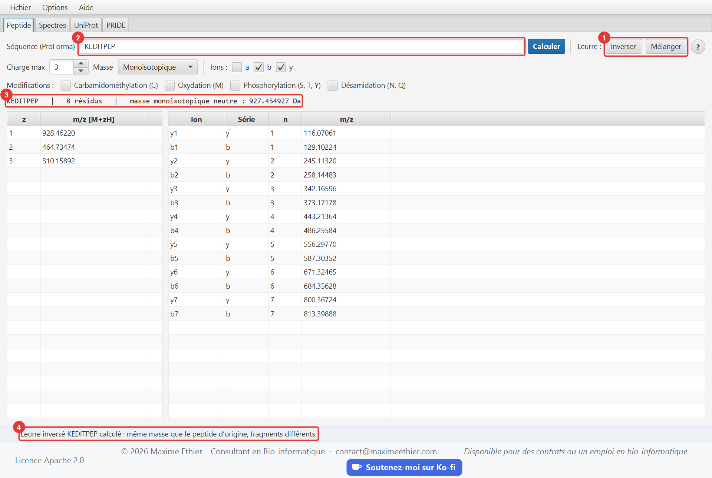

| # | Élément | Description |
|---|---|---|
| 1 | Inverser / Mélanger | **Inverser** lit les résidus à l’envers (`ACDEFGH` devient `HGFEDCA`). **Mélanger** les place dans un ordre aléatoire ; chaque clic donne un nouvel ordre. |
| 2 | Séquence | Remplacée par le leurre ; un nouveau clic sur **Inverser** rend la séquence d’origine. |
| 3 | Résumé | Masse du leurre. |
| 4 | Barre d’état | Rappelle que la masse ne change pas. |

Un leurre contient exactement les mêmes résidus : sa **masse et ses rapports m/z sont identiques**
à ceux du peptide d’origine, c’est ce qui en fait un concurrent crédible. Seuls ses **ions
fragments** changent, et c’est sur eux que le spectre départage le vrai peptide du leurre.
Les modifications suivent leur résidu ; celles des extrémités restent aux extrémités.

## Erreurs de saisie

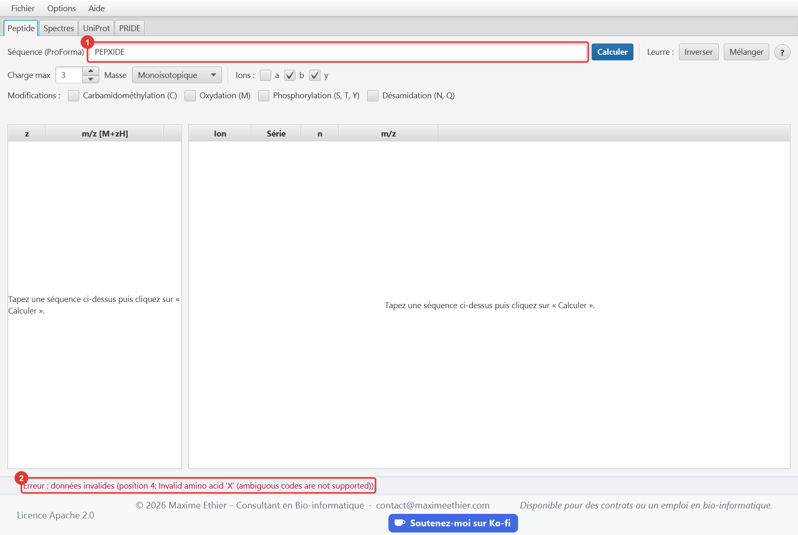

| # | Élément | Description |
|---|---|---|
| 1 | Séquence invalide | `PEPXIDE` contient `X`, un code ambigu sans masse définie. |
| 2 | Barre d’état | Le message rouge indique la **position** du caractère fautif (ici la 4e). |

Les codes ambigus `B`, `J`, `X` et `Z` sont refusés, de même que les modifications inconnues et les
crochets non fermés. Les 22 acides aminés standards (y compris `U` sélénocystéine et `O`
pyrrolysine) sont acceptés.

<!-- section: spectra -->
# Onglet Spectres

Ouvre des spectres MS/MS (fichier JSON ou MGF, ou PRIDE) et vérifie qu’un peptide les explique en
retrouvant ses ions b et y.

## Ouvrir un fichier

Cliquez sur **Ouvrir un fichier…** (ou **Fichier > Ouvrir un fichier de spectres…**, Ctrl+O). La
première fois, la boîte de dialogue s’ouvre sur le dossier des **fichiers d’exemple** fourni avec
l’application. Ici, `02-hemoglobin-alpha-tryptic.json` :

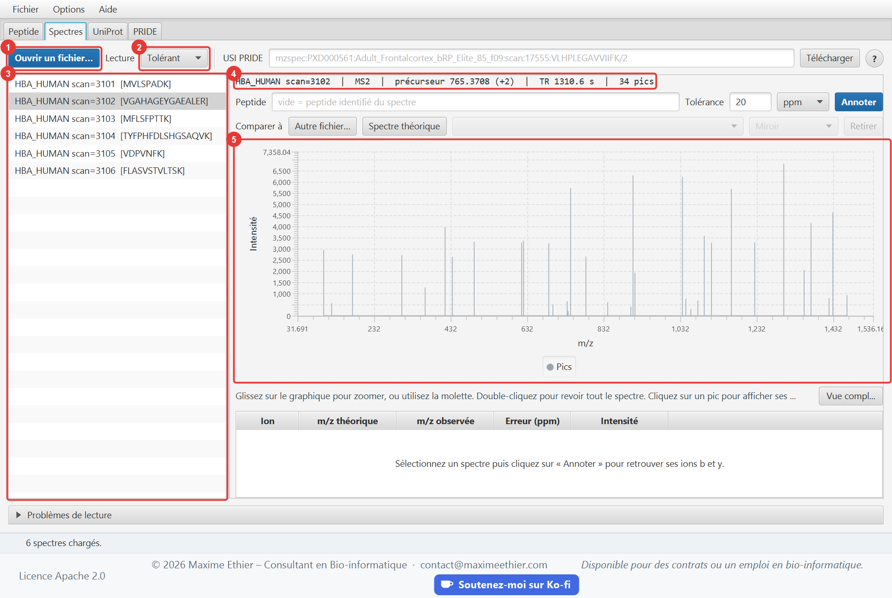

| # | Élément | Description |
|---|---|---|
| 1 | Ouvrir un fichier… | Ouvre un fichier de spectres JSON ou MGF, compressé (`.gz`) ou non. **Le chargement remplace la liste actuelle.** |
| 2 | Lecture | **Tolérant** : les spectres ou pics invalides sont ignorés et signalés. **Strict** : la première erreur rejette tout le fichier. À choisir **avant** d’ouvrir le fichier. |
| 3 | Liste des spectres | Un clic sélectionne un spectre ; le peptide identifié est affiché entre crochets. |
| 4 | Détails | Identifiant, niveau MS, m/z et charge du précurseur, temps de rétention (TR), nombre de pics. |
| 5 | Graphique | Spectre en bâtons : m/z en abscisse, intensité en ordonnée. Agrandissez la fenêtre pour plus de détail. |

## Annoter un spectre

L’annotation recherche dans le spectre les pics qui correspondent aux ions b et y théoriques d’un
peptide.

1. Sélectionnez un spectre dans la liste.
2. Laissez le champ **Peptide** vide pour utiliser l’identification du spectre, ou tapez un autre
   peptide pour le tester.
3. Réglez la **tolérance** si besoin (20 ppm par défaut).
4. Cliquez sur **Annoter** (ou appuyez sur Entrée dans le champ Peptide).

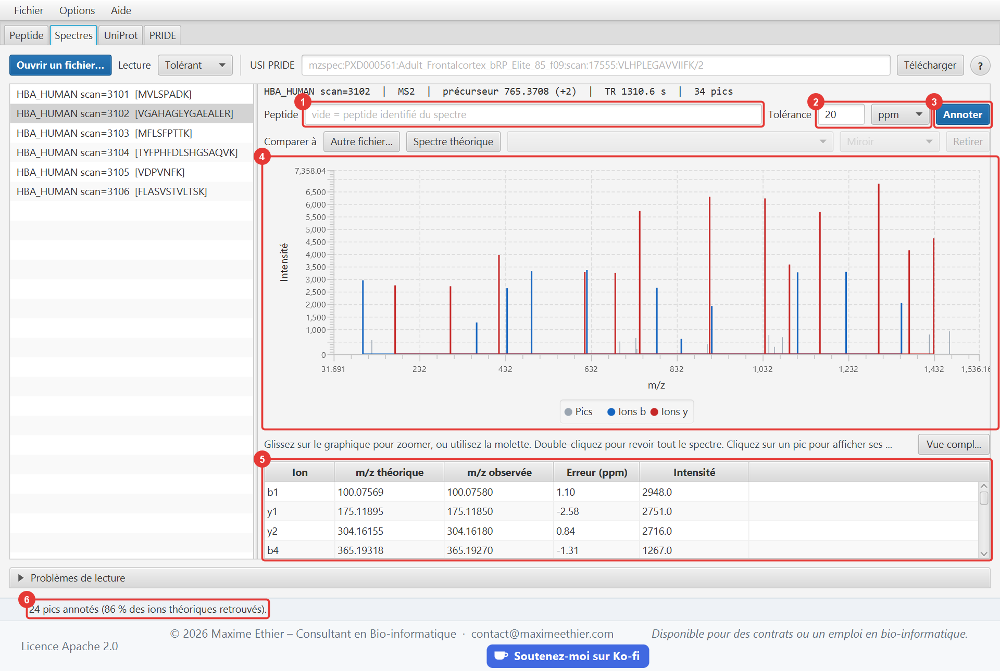

| # | Élément | Description |
|---|---|---|
| 1 | Peptide | Vide = peptide associé au spectre. Même notation que l’onglet Peptide. |
| 2 | Tolérance | Écart maximal entre m/z observée et théorique, en **ppm** (relatif) ou en **Da** (absolu). Orbitrap : 10 à 20 ppm. Trappe ionique : environ 0,5 Da. |
| 3 | Annoter | Lance l’annotation. |
| 4 | Graphique annoté | **Bleu** : ions b (N-terminaux). **Rouge** : ions y (C-terminaux). **Gris** : pics non expliqués. |
| 5 | Tableau des annotations | Pour chaque pic expliqué : ion, m/z théorique, m/z observée, erreur en ppm, intensité. |
| 6 | Barre d’état | Nombre de pics annotés et **couverture** (part des ions théoriques retrouvés). |

**Lire le résultat** : une forte couverture et des erreurs faibles et homogènes (quelques ppm)
indiquent que le peptide explique bien le spectre. Pour comparer, tapez un autre peptide (par
exemple `PEPTIDE`) : beaucoup moins de pics sont annotés.

> Changer de spectre efface l’annotation : cliquez de nouveau sur **Annoter** pour le nouveau
> spectre. Pour un spectre de charge z, les fragments sont cherchés jusqu’à la charge z − 1.

## Zoomer et inspecter un pic

Un spectre compte souvent des centaines de pics serrés. Le graphique permet de s’en approcher :

- **Glisser** horizontalement sur le graphique : zoome sur la plage de m/z sélectionnée.
- **Molette** de la souris : zoome ou dézoome autour du pointeur.
- **Double-clic** ou bouton **Vue complète** : revient au spectre entier.
- **Clic sur un pic** : le pic est surligné en orange et décrit sous le graphique (m/z, intensité,
  pourcentage du pic de base). S’il est annoté, l’ion, sa m/z théorique et l’erreur en ppm sont
  indiqués, et sa ligne est sélectionnée dans le tableau des annotations.

L’axe des intensités s’adapte au pic le plus haut de la zone affichée : les petits pics restent
lisibles après un zoom. À l’inverse, sélectionner une ligne du tableau des annotations surligne le
pic correspondant. Le zoom est conservé quand vous annotez de nouveau le même spectre.

## Comparer avec un spectre de référence

La ligne **Comparer à** affiche un second spectre en **miroir** (vers le bas) ou **superposé**
(vers le haut), et mesure leur ressemblance. La référence peut être :

- le spectre **théorique** du peptide saisi dans le champ Peptide, ou du peptide identifié du
  spectre si ce champ est vide ; il suit alors l’identification quand vous changez de spectre ;
- un spectre d’un **autre fichier** MGF ou JSON (bouton **Autre fichier…**) ; le spectre identifié
  avec le même peptide est choisi d’office ;
- un spectre de la liste : clic droit, **Utiliser comme spectre de référence**.

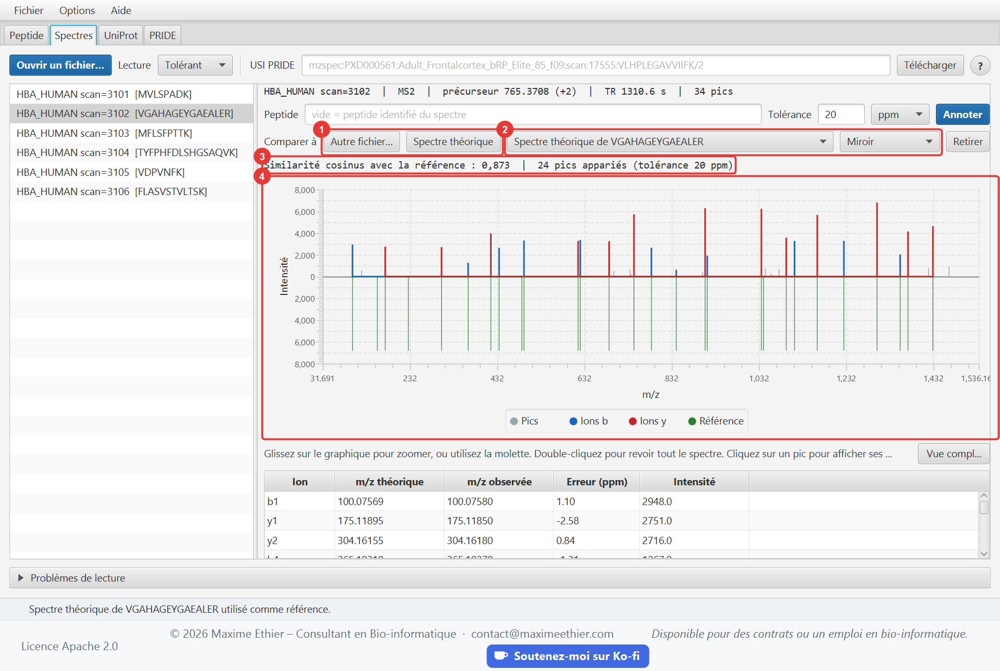

| # | Élément | Description |
|---|---|---|
| 1 | Autre fichier… / Spectre théorique | Choisit la source de la référence. |
| 2 | Référence et affichage | Liste des spectres de référence disponibles ; **Miroir** ou **Superposition**. **Retirer** arrête la comparaison. |
| 3 | Similarité | Cosinus entre les deux spectres, de 0 (aucun pic commun) à 1 (mêmes pics, intensités proportionnelles), et nombre de pics appariés. |
| 4 | Graphique | La référence est en **vert**, mise à l’échelle du pic de base du spectre sélectionné. |

Les pics sont appariés avec la **tolérance** de l’annotation. Le cosinus porte sur la racine
carrée des intensités, la pratique habituelle, pour que quelques pics dominants n’écrasent pas les
autres. Un spectre théorique donne la même intensité à tous ses ions (moitié pour les ions
doublement chargés) : un cosinus de 0,6 à 0,9 avec un spectre réel est déjà un bon accord. Deux
spectres expérimentaux du même peptide dépassent souvent 0,9.

## Problèmes de lecture

Le fichier d’exemple `07-parsing-errors.json` contient volontairement des erreurs. En mode
**Tolérant**, les entrées valides sont chargées et chaque problème est listé en bas de l’onglet, qui
se déplie automatiquement :

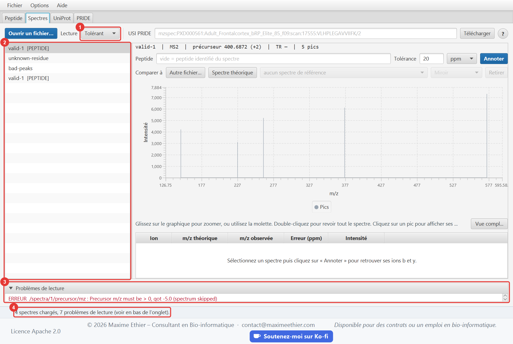

| # | Élément | Description |
|---|---|---|
| 1 | Lecture | Mode Tolérant : le fichier est chargé malgré les erreurs. En mode Strict, le chargement échouerait dès la première erreur. |
| 2 | Spectres chargés | Seuls les spectres valides (ou réparables) sont listés. |
| 3 | Problèmes de lecture | Chaque ligne indique la gravité, l’**emplacement** dans le fichier (`/spectra/1/precursor/mz` = 2e spectre, champ precursor.mz) et la cause. **ERREUR** : spectre ignoré. **AVERTISSEMENT** : pic ou identification ignoré, spectre conservé. |
| 4 | Barre d’état | Nombre de spectres chargés et de problèmes. |

Les messages techniques des problèmes de lecture sont en anglais, quelle que soit la langue de
l’interface.

## Télécharger un spectre depuis PRIDE (USI)

Un USI (*Universal Spectrum Identifier*) désigne un spectre précis dans un jeu de données public.
Collez-le dans le champ **USI PRIDE** puis cliquez sur **Télécharger**. Le texte grisé du champ vide
n’est qu’un exemple ; à copier :

```
mzspec:PXD000561:Adult_Frontalcortex_bRP_Elite_85_f09:scan:17555:VLHPLEGAVVIIFK/2
```

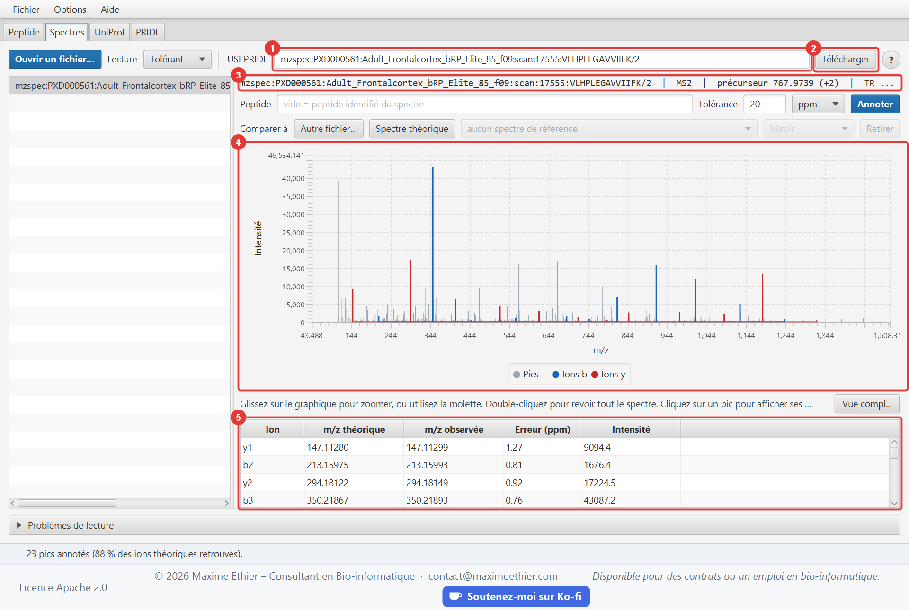

| # | Élément | Description |
|---|---|---|
| 1 | USI PRIDE | Identifiant du spectre. La fin `VLHPLEGAVVIIFK/2` est le peptide identifié et sa charge. |
| 2 | Télécharger | Récupère le spectre par l’API PROXI de PRIDE, ou par ProteomeCentral quand PRIDE ne répond pas. |
| 3 | Détails | 564 pics, précurseur 767,9739 (2+) ; la valeur théorique est 767,9714, soit un écart de 3,3 ppm. |
| 4 | Graphique | Après **Annoter** : 23 pics expliqués, soit 88 % des ions b/y théoriques. |
| 5 | Annotations | Erreurs de masse toutes inférieures à 2 ppm. |

Ce même spectre est fourni hors ligne : `samples/04-pride-proxi-VLHPLEGAVVIIFK.json`.

<!-- section: uniprot -->
# Onglet UniProt

Récupère une protéine dans UniProtKB et la digère *in silico* pour lister ses peptides théoriques.

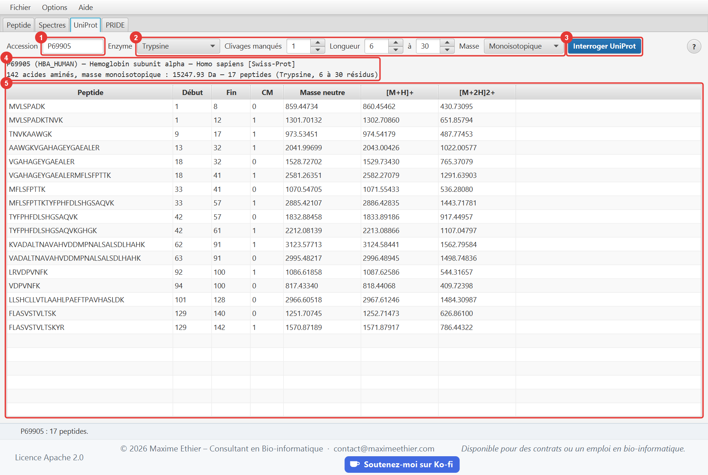

| # | Élément | Description |
|---|---|---|
| 1 | Accession | Par exemple `P69905` (hémoglobine α humaine), `P02769` (albumine bovine) ou `P00924` (énolase de levure). Une isoforme s’écrit `P69905-2`. |
| 2 | Paramètres | **Enzyme** : Trypsine (coupe après K/R sauf devant P), Trypsine/P (coupe aussi devant P), Lys-C (après K), Arg-C (après R), Glu-C (après E), Asp-N (devant D), Chymotrypsine (après F/Y/W sauf devant P). **Clivages manqués** : nombre de sites internes non coupés tolérés. **Longueur** : plage de longueur des peptides conservés (6 à 30 résidus par défaut ; élargissez le maximum pour Lys-C ou Glu-C, qui produisent des peptides plus longs). **Masse** : monoisotopique ou moyenne. |
| 3 | Interroger UniProt | Télécharge la fiche UniProt et calcule la digestion. |
| 4 | Résumé | Nom de la protéine, organisme, statut Swiss-Prot (révisée) ou TrEMBL, longueur, masse totale, nombre de peptides. |
| 5 | Peptides | Peptides de la plage de longueur choisie : positions de début et de fin (base 1), clivages manqués (CM), masse neutre, [M+H]+ et [M+2H]2+. |

En masse **moyenne**, P69905 pèse environ 15 258 Da, la valeur indiquée par UniProt. Les peptides
contenant des résidus ambigus (`X`, `B`, `Z`) sont exclus et comptés à part dans le résumé.

**Envoyer un peptide vers un autre onglet** :

- **Double-clic** sur un peptide : il est calculé dans l’onglet Peptide (ions fragments, états de
  charge), avec les options choisies dans cet onglet.
- **Clic droit** sur un peptide : *Calculer dans l’onglet Peptide*, *Annoter le spectre sélectionné
  avec ce peptide* (onglet Spectres) ou *Copier la séquence*.

> Astuce : les spectres de `samples/02-hemoglobin-alpha-tryptic.json` et
> `05-unidentified-spectra.json` proviennent de peptides trypsiques de P69905. Sélectionnez un
> spectre dans l’onglet Spectres, comparez la m/z de son précurseur à la colonne [M+2H]2+, puis
> faites un clic droit sur le peptide candidat › *Annoter le spectre sélectionné avec ce peptide*.

<!-- section: pride -->
# Onglet PRIDE

Recherche des projets déposés dans PRIDE Archive, la base publique de données de protéomique de
l’EMBL-EBI, affiche leur fiche et leurs fichiers, et télécharge leurs spectres dans l’onglet
**Spectres**.

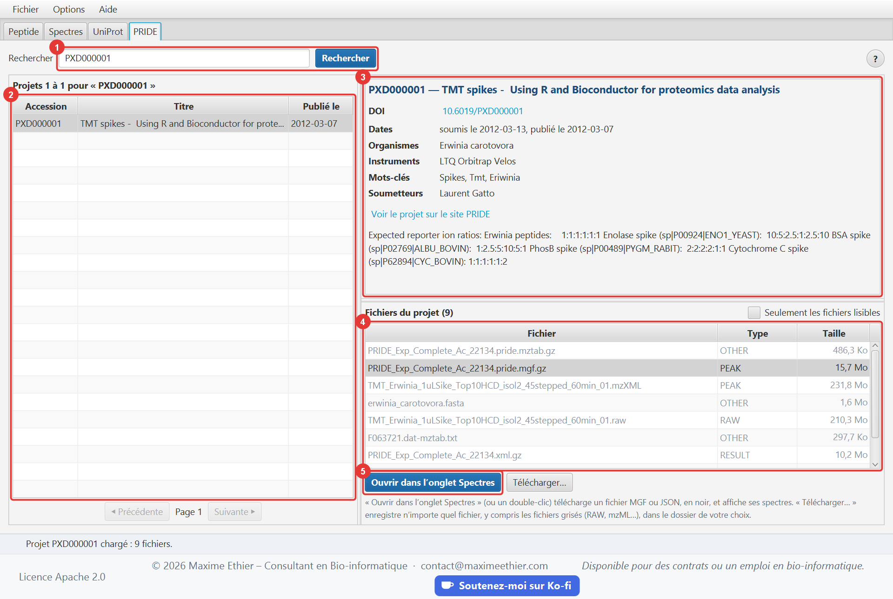

| # | Élément | Description |
|---|---|---|
| 1 | Rechercher | Une accession (PXD suivi de 6 chiffres, par exemple `PXD000001`) ouvre directement le projet. Des mots-clés (`hemoglobin human`, un nom d’espèce ou d’instrument…) lancent une recherche. |
| 2 | Résultats | 25 projets par page ; **Précédente** et **Suivante** changent de page. Un clic sur un projet affiche sa fiche et ses fichiers. |
| 3 | Fiche du projet | Titre, DOI (cliquable), dates, organismes, instruments, mots-clés, soumetteurs et description, avec un lien vers la page du projet sur le site PRIDE. |
| 4 | Fichiers du projet | Nom, type et taille de chaque fichier. Les fichiers grisés ne sont pas lisibles par l’application ; cochez **Seulement les fichiers lisibles** pour les masquer. |
| 5 | Ouvrir dans l’onglet Spectres | Télécharge le fichier sélectionné (ou double-clic sur la ligne) puis affiche ses spectres dans l’onglet **Spectres**. Le bouton voisin, **Télécharger…**, enregistre le fichier dans le dossier de votre choix. |

## Télécharger les fichiers d’un projet

Deux boutons, sous la liste des fichiers :

- **Ouvrir dans l’onglet Spectres** (ou double-clic) : pour les fichiers **MGF** et **JSON**,
  compressés (`.gz`) ou non. Le fichier est téléchargé dans un dossier temporaire puis ses spectres
  s’affichent dans l’onglet **Spectres**. Les fichiers bruts des spectromètres (`.raw`, `.wiff`…),
  les formats mzML et mzXML, et les résultats d’identification ne sont pas lisibles.
- **Télécharger…** : pour **n’importe quel fichier**, y compris les fichiers grisés. Choisissez un
  dossier (par défaut, votre dossier *Téléchargements*) : le fichier y est enregistré sous son nom
  d’origine, et la barre d’état indique où. L’application retient le dossier choisi.

Avant le téléchargement, l’application demande au serveur la taille exacte du fichier. Au-delà de
**50 Mo**, ou si la taille est inconnue, une fenêtre d’avertissement affiche la taille et demande de
confirmer ou d’annuler. Pendant le téléchargement, une barre de progression et un bouton **Annuler**
apparaissent sous la liste des fichiers ; la barre d’état indique le pourcentage reçu.

> Les serveurs de PRIDE limitent le débit de chaque connexion : l’application télécharge donc les
> fichiers de plus de 2 Mo en plusieurs morceaux à la fois. Comptez tout de même environ 30 secondes
> pour le fichier MGF de 6 Mo de `PXD000001`.

> Un fichier n’est jamais téléchargé deux fois : celui enregistré avec **Télécharger…** s’ouvre
> directement dans l’onglet Spectres, et celui déjà ouvert est simplement copié par
> **Télécharger…**. Les fichiers ouverts restent dans le dossier temporaire du système.

> La taille affichée dans la liste est celle déclarée par PRIDE ; elle diffère parfois de la taille
> réelle, que la fenêtre d’avertissement indique.

Pour ouvrir un seul spectre d’un projet, utilisez plutôt son USI dans l’onglet **Spectres**.

<!-- section: samples -->
# Fichiers d’exemple

Le dossier `samples`, livré à côté de l’application, contient des fichiers prêts à analyser.
Ouvrez-le avec **Fichier > Ouvrir le dossier des fichiers d’exemple**. La boîte de dialogue **Ouvrir
un fichier…** s’y place automatiquement la première fois.

| Fichier | Contenu | À essayer |
|---|---|---|
| `01-demo-peptides.json` | 3 spectres identifiés : PEPTIDE, ELVISLIVESK, SAMPLER | Sélectionner chaque spectre puis **Annoter** (75 à 90 % de couverture). |
| `02-hemoglobin-alpha-tryptic.json` | 6 peptides trypsiques de l’hémoglobine α humaine (P69905), dont un de charge 3+ | Comparer avec la digestion de P69905 dans l’onglet UniProt. |
| `03-ptm-modifications.json` | Peptides modifiés : acétylation, oxydation, phosphorylation, carbamidométhylation, décalage de masse, amidation C-terminale | Annoter, puis retirer la modification du champ Peptide : la couverture chute. |
| `04-pride-proxi-VLHPLEGAVVIIFK.json` | Spectre réel du projet PRIDE PXD000561 (Orbitrap Velos), au format PROXI | Annoter : 23 pics, 88 % de couverture, erreurs inférieures à 2 ppm. |
| `05-unidentified-spectra.json` | 3 spectres **sans** identification (unknown-A, B, C) | Exercice : trouver le peptide (voir ci-dessous). |
| `06-peak-formats.json` | Les trois façons d’écrire les pics : objets, tableaux parallèles, paires avec nombres entre guillemets | Modèle pour écrire vos propres fichiers. |
| `07-parsing-errors.json` | 7 entrées dont plusieurs invalides | Ouvrir en mode **Tolérant**, puis en mode **Strict**, et comparer. |

Les fichiers `01`, `02`, `03` et `05` sont des spectres **synthétiques** : pics calculés à partir de
la séquence, avec une erreur de masse de quelques ppm, des ions manquants et des pics de bruit. Le
fichier `04` est un vrai spectre public.

## Exercice : identifier un spectre inconnu

1. Ouvrez `05-unidentified-spectra.json` et sélectionnez `unknown-A`. Notez la m/z et la charge de
   son précurseur.
2. Dans l’onglet **UniProt**, digérez `P69905` (Trypsine, 1 clivage manqué) et cherchez un peptide
   dont la colonne [M+2H]2+ est égale à cette m/z (à 0,01 près).
3. Revenez à l’onglet **Spectres**, tapez ce peptide dans le champ **Peptide** et cliquez sur
   **Annoter**. Une couverture supérieure à 60 % confirme l’identification ; essayez un mauvais
   candidat pour comparer.

Solutions : unknown-A = `VGAHAGEYGAEALER`, unknown-B = `MFLSFPTTK`, unknown-C = `FLASVSTVLTSK`.

<!-- section: json-format -->
# Format des fichiers JSON

Le lecteur accepte trois formes de document : un objet spectre seul, un tableau de spectres, ou un
objet `{ "spectra": [ ... ] }`.

```json
{
  "spectra": [
    {
      "id": "scan=1001",
      "msLevel": 2,
      "retentionTime": 1520.4,
      "peptide": "PEPTIDE",
      "precursor": { "mz": 400.6872, "charge": 2 },
      "peaks": [
        { "mz": 148.0604, "intensity": 4200 },
        [ 263.0874, 5200 ]
      ]
    }
  ]
}
```

| Champ | Obligatoire | Description |
|---|---|---|
| `id` | non | Identifiant. Par défaut `index=0`, `index=1`… Les doublons sont signalés. |
| `msLevel` | non | 1, 2… Par défaut 2 s’il y a un précurseur, sinon 1. |
| `precursor` | non | `{ "mz": …, "charge": … }`. On peut aussi écrire `precursorMz` et `precursorCharge` à la racine du spectre. |
| `retentionTime` (ou `rt`) | non | En secondes, positif. |
| `peptide` (ou `sequence`) | non | Peptide identifié, en notation ProForma. S’il est invalide, il est ignoré en mode Tolérant. |
| `peaks` | **oui*** | Liste de pics : objets `{ "mz", "intensity" }` ou paires `[mz, intensité]`. |
| `mz` + `intensity` | **oui*** | *Alternative à peaks* : deux tableaux parallèles de même longueur. |

Règles de validation : m/z strictement positive, intensité positive ou nulle, nombres finis. Les
nombres écrits entre guillemets (`"400.5"`) sont acceptés. Les clés en double et le JSON mal formé
sont refusés ; la ligne et la colonne de l’erreur sont alors indiquées.

Le format **PROXI** renvoyé par PRIDE (`usi`, `mzs`, `intensities`, `attributes` avec les codes
PSI-MS) est reconnu automatiquement : un spectre téléchargé depuis PRIDE s’ouvre tel quel.

<!-- section: options -->
# Menus, langue et taille du texte

## Menu Fichier

- **Ouvrir un fichier de spectres…** (Ctrl+O) : affiche l’onglet Spectres et ouvre un fichier JSON
  ou MGF.
- **Ouvrir le dossier des fichiers d’exemple** : ouvre le dossier `samples` dans l’explorateur de
  fichiers.
- **Quitter** (Ctrl+Q).

## Menu Options

- **Langue** : English ou Français. L’interface et ce guide changent de langue immédiatement, sans
  perdre les résultats affichés.
- **Taille du texte** : Petite, Normale, Grande, Très grande, ou réglage fin avec **Agrandir le
  texte** (Ctrl+=), **Réduire le texte** (Ctrl+−) et **Taille de texte par défaut** (Ctrl+0). La
  fenêtre d’aide et les boîtes de dialogue suivent le même réglage.

La langue, la taille du texte, la taille de la fenêtre et le dernier dossier ouvert sont mémorisés
pour la prochaine session. Au premier lancement, la langue est celle du système (anglais si elle
n’est pas prise en charge).

## Menu Aide

- **Guide d’utilisation** (F1) : ce guide, ouvert sur la section de l’onglet affiché.
- **Raccourcis clavier** : liste de tous les raccourcis.
- Liens vers les sites **UniProt**, **PRIDE Archive** et la spécification **ProForma**.
- **À propos** : version, auteur, sources des données et références.

## Rechercher dans le guide

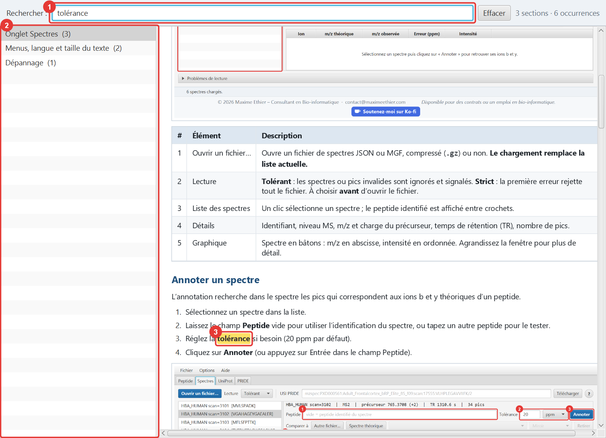

| # | Élément | Description |
|---|---|---|
| 1 | Recherche | Tapez un ou plusieurs mots : seules les sections qui les contiennent **tous** restent listées. Les accents et majuscules sont ignorés (`tolerance` trouve « tolérance »). Ctrl+F place le curseur dans ce champ, Échap l’efface. |
| 2 | Sections | Une section par onglet de l’application, plus les sujets généraux. Le nombre d’occurrences est indiqué entre parenthèses. |
| 3 | Contenu | Les mots trouvés sont surlignés en jaune ; la page défile jusqu’à la première occurrence. |

<!-- section: troubleshooting -->
# Dépannage

| Symptôme | Cause et solution |
|---|---|
| Je ne trouve pas le bouton **Annoter** | Onglet **Spectres**, au bout de la ligne « Peptide », à droite du choix ppm/Da. Agrandissez la fenêtre ou réduisez la taille du texte s’il est coupé. |
| Mes spectres précédents ont disparu | Chaque ouverture de fichier ou téléchargement **remplace** la liste. |
| « Erreur : saisie invalide (… has no identification) » lors de l’annotation | Le spectre n’a pas de peptide associé : tapez-en un dans le champ **Peptide**. |
| 0 pic annoté | Tolérance trop stricte, mauvais peptide, ou modification manquante (Met oxydée, Cys carbamidométhylée…). Essayez 0,5 Da pour vérifier. |
| « accession introuvable » | L’accession n’existe pas dans UniProt ou PRIDE. Vérifiez-la sur le site correspondant (menu Aide). |
| « UniProt entry … is inactive » | L’entrée a été supprimée ou fusionnée dans UniProt. Cherchez l’accession actuelle sur uniprot.org. |
| « service injoignable » | Pas d’accès Internet, pare-feu, ou service momentanément indisponible. Réessayez plus tard. |
| Le bouton **Ouvrir dans l’onglet Spectres** reste grisé | Le fichier sélectionné n’est pas au format MGF ou JSON, ou un téléchargement est déjà en cours. Pour l’enregistrer quand même, utilisez **Télécharger…**. |
| Le téléchargement d’un fichier PRIDE est très long | Les serveurs de PRIDE sont parfois lents. Cliquez sur **Annuler** et choisissez un fichier plus petit, ou réessayez plus tard. |
| Le texte est trop petit ou trop grand | Menu **Options > Taille du texte**, ou Ctrl+= / Ctrl+− / Ctrl+0. |
| L’interface est en anglais | Menu **Options > Langue > Français**. |
